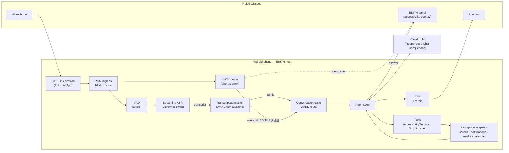
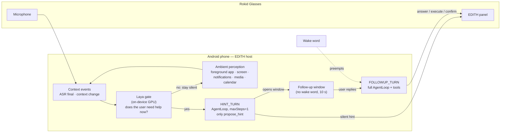

<div align="center">
  <picture>
    
  </picture>
</div>

<h3 align="center">
EDITH: An Always-On Proactive AI Agent on Android, Connected to Rokid Glasses
</h3>

<p align="center">
  | <a href="#demo-videos"><b>Demo</b></a> |
  <a href="#technical-routes"><b>Technical routes</b></a> |
  <a href="#project-structure"><b>Project structure</b></a> |
  <a href="#notes"><b>Setup notes</b></a> |
  <a href="LICENSE"><b>Apache-2.0</b></a> |
</p>

<p align="center">
  <strong>English</strong> | <a href="README.zh-CN.md">简体中文</a>
</p>

> **Preview status:** EDITH is currently in preview. Its features are usable, but performance,
> stability and the overall experience still need optimization.

EDITH (伊迪丝) is an end-cloud collaborative AI agent: an Android host app on your phone plus a
custom app on Rokid Glasses. The glasses are its microphone, speaker and display; the phone is its
ears, hands, memory and brain. Microphone audio streams from the glasses over the Rokid AI App's
CXR-Link session; the phone segments and transcribes it on-device, calls the LLM you configure,
operates Android apps through the accessibility service and Shizuku's shell, and communicates with
the user through text on the glasses HUD and TTS audio.

- **Wake-word route** — Say “EDITH” or “伊迪丝”. The glasses panel opens, EDITH listens, recognizes
  the intent, perceives the phone (screen, notifications, media, calendar, device state), plans and
  executes multi-step actions in other apps (open apps/pages, tap, type Chinese text, scroll, dial,
  run shell commands), then answers on the glasses HUD and speaks the answer. It keeps listening
  for a follow-up utterance without another wake word inside the 10-second listening window.
- **Proactive route** — After you tap “Start” once, EDITH keeps listening and watching ambient
  context. A small on-device gate model (Laya, GPU) decides whether the user needs help right now;
  if so, EDITH pushes a silent hint to the glasses **without any wake word** and opens a 10-second
  follow-up window. After the user replies, a full agent turn runs immediately.

## Demo videos

**Wake-word route** — say “EDITH” or “伊迪丝”; the panel opens and EDITH executes the request.

<div align="center">
  <a href="docs/assets/videos/wake-up.mp4">
    
  </a>
</div>

**Proactive route** — EDITH notices the context, offers help without a wake word, and continues after the reply.

<div align="center">
  <a href="docs/assets/videos/proactive.mp4">
    
  </a>
</div>

## Compatibility and dependencies

The versions below are the configuration EDITH is developed and tested against. Newer firmware or
app versions may work, but they are not part of the validated baseline.

| Component | Version |
| --- | --- |
| Android phone | Android 9+ (`minSdk 28`); tested on Redmi K40, Android 13 / API 33 |
| Rokid AI App | `1.14.19.0920` (mainland build, `com.rokid.sprite.aiapp`, versionCode `10140019`) |
| Rokid Glasses | firmware `1.26.011-20260929-150201` (RG-glasses, Android 12 / API 32, 480×640) |
| Glasses link | CXR-Link SDK `client-l 1.1.2` + service bridge `1.0-20260715.121510-107` |
| Shizuku | `13.5.4+` (built against API `13.1.5`; device-tested with `13.6.0`) |
| Build toolchain | JDK 17, Android SDK Platform 35, Gradle wrapper 9.4.1 |

All on-device model sets together take about **1.0 GiB** (1.03 GiB); see
[Model files](#2-model-files-required) below.

## Technical routes

### Wake-word route

Glasses microphone → CXR audio stream → PCM ingress. The same PCM stream feeds two consumers:
wake-word spotting (KWS) and VAD + streaming ASR. A KWS hit on “EDITH / 伊迪丝” raises a wake
event, opens the glasses panel and opens a WAKE turn; VAD/ASR runs continuously from session start
(it cannot wait for the wake: the wake word is usually at the start of the utterance, and the
proactive route has no wake word at all). A final transcript is admitted into the Agent only while
the WAKE turn is waiting for it — with no turn waiting, a final does not open a wake turn; it goes
to the proactive trigger path instead. `AgentLoop` with the configured cloud model → tool execution
and perception → answer on the glasses panel and phone-side TTS. The same CXR session also carries
the display commands and the follow-up audio.



**Components:** Rokid Glasses microphone/HUD/speaker · Rokid AI App CXR-Link transport
(`transport-rokid`: session, audio callback, custom commands, authorization) · PCM ingress ·
sherpa-onnx keyword spotter (8 phase-diversified streams) · Silero VAD · sherpa-onnx streaming
Zipformer ASR (bilingual zh/en, fp32 decoder) · `plugin-smart-helper` (WAKE route, prompts, memory,
skills, tool policy) · `agent-runtime` (`AgentLoop`, request assembly) · `model-runtime`
(Responses / Chat Completions over SSE) · `host-runtime` / `output-runtime` (output arbitration,
hint codec) · phone accessibility service and Shizuku shell (tool execution) · Android TTS over
Bluetooth.

### Proactive route

The session stays resident after one “Start”. Ambient perception and the CXR audio stream keep
running; context changes are events. A lightweight on-device gate decides whether the user needs
help right now, without calling the cloud model; a positive decision becomes a single hint turn
whose only tool is `propose_hint`. A reply to the hint runs a full agent turn.



**Components:** resident session (`SessionService`, CXR audio, KWS/VAD/ASR) · perception snapshot
(`AndroidPerceptionProvider`) · Laya gate (`SystemOneService`, on-device GPU) · HINT_TURN
(`AgentLoop` with a terminal `propose_hint` tool) · `ConversationCycle` follow-up window · the same
tool face as the wake route for FOLLOWUP_TURN · glasses overlay panel via CXR custom commands.
When the gate declines, **zero** model requests are made. The two routes use independent
`ConversationStore`s.

## Project structure

- `phone-app/` — Android phone host: session and plugin host, perception, speech, model runtime, native action channels (accessibility / Shizuku)
- `glasses-app/` — glasses CustomApp: CXR-S bridge, overlay panel and rendering
- `common/` — contracts and presentation / output modules shared by both ends
- `tools/` — probes, evaluation harness and scripts (not shipped)
- `third_party/` — vendored build inputs such as the CXR SDK
- `docs/` — project documents, evidence, brand and demo assets

## Notes

### 1. Accessibility service (required)

EDITH cannot read the screen or act in other apps without Android's accessibility service. Two
services are involved:

- **Phone** — `com.sheen.rokid.phone/.actions.a11y.EdithAccessibilityService`: screen reading,
  semantic click / long-press / scroll, Chinese text input and screenshots.
- **Glasses** — `com.sheen.rokid.glasses/.accessibility.GlassesAccessibilityService`: it only lends
  its window token so the panel can be drawn as `TYPE_ACCESSIBILITY_OVERLAY` above the vendor home
  HUD (a system window that covers ordinary app overlays; the accessibility overlay's base layer
  311000 sits above the HUD's 271000). It reads no window content and draws nothing itself.

Enable each one over ADB. **Always read the current list first and append** — another app's service
may already be enabled and must not be overwritten. A written setting is not a bound service:
verify the binding in `dumpsys accessibility`.

```powershell
$phone   = "<phone-serial>"
$service = "com.sheen.rokid.phone/com.sheen.rokid.phone.actions.a11y.EdithAccessibilityService"

$old = (adb -s $phone shell settings get secure enabled_accessibility_services).Trim()
$new = if ([string]::IsNullOrWhiteSpace($old) -or $old -eq "null") { $service }
elseif (($old -split ":") -contains $service) { $old }   # already enabled: do not duplicate
else { "$old`:$service" }
adb -s $phone shell settings put secure enabled_accessibility_services $new
adb -s $phone shell settings put secure accessibility_enabled 1

# Must show the EDITH service under "Bound services"; a stored value alone is not proof.
adb -s $phone shell dumpsys accessibility | Select-String "Bound services|EDITH"
```

Use the same pattern on the glasses with component
`com.sheen.rokid.glasses/com.sheen.rokid.glasses.accessibility.GlassesAccessibilityService` and
serial `<glasses-serial>`.

### 2. Model files (required)

**Model download link:** [Quark Drive](https://pan.quark.cn/s/d53caa9e395f?pwd=veEd)

EDITH needs four local model sets. They are runtime dependencies, not optional add-ons: the
assistant plugin declares ASR, SystemOne (Laya), Embedding and Perception as required capabilities,
so a missing model set fails session activation.

| Model set | Contents | Where it goes |
| --- | --- | --- |
| ASR engine bundle | encoder / decoder / joiner (ONNX), tokens, Silero VAD, speaker model, plus `engine-manifest.json` | Phone app-private `no_backup/engine-models-import/`, imported on cold start (debug build) |
| Wake-word (KWS) model | sherpa-onnx KWS Zipformer zh/en 3M: 5 files | Build machine: `.local/p3-kws-model/sherpa-onnx-kws-zipformer-zh-en-3M-2025-12-20/`; packaged into the APK as `assets/kws/` |
| Proactive gate (Laya) | Laya-Multilingual-LiteRT set: 7 files | Phone app-internal `files/` |
| Memory embedding | EmbeddingGemma 300M `.tflite` + SentencePiece vocabulary | Phone external files `Android/data/com.sheen.rokid.phone/files/models/embeddinggemma/` |

**ASR engine bundle** (push the whole bundle, then cold-start the app; `logcat` should print
`EdithHost: ENGINE_IMPORTED`):

```powershell
$phone = "<phone-serial>"
adb -s $phone push <models>/asr /data/local/tmp/edith-asr
adb -s $phone shell "run-as com.sheen.rokid.phone mkdir -p no_backup/engine-models-import"

# Repeat for engine-manifest.json and every artifact it declares (encoder/decoder/joiner/tokens/vad/speaker):
adb -s $phone shell "cat /data/local/tmp/edith-asr/<file> | run-as com.sheen.rokid.phone sh -c 'cat > no_backup/engine-models-import/<file>'"

adb -s $phone shell am force-stop com.sheen.rokid.phone   # then reopen the app once
```

**Laya gate** (seven files into the app's internal `files/`):

```powershell
$phone = "<phone-serial>"
adb -s $phone push <models>/laya /data/local/tmp/edith-laya
adb -s $phone shell "run-as com.sheen.rokid.phone mkdir -p files"

# Repeat for each of the seven files:
adb -s $phone shell "cat /data/local/tmp/edith-laya/<file> | run-as com.sheen.rokid.phone sh -c 'cat > files/<file>'"
```

**Memory embedding**:

```powershell
adb -s $phone shell "mkdir -p /sdcard/Android/data/com.sheen.rokid.phone/files/models"
adb -s $phone push <models>/embeddinggemma /sdcard/Android/data/com.sheen.rokid.phone/files/models/
```

**KWS model**: the Gradle build reads the five files from the `.local/...` path above, verifies their
SHA-256, and packages them as `assets/kws/` (together with the tracked `keywords.txt`). If the
directory is absent the build still succeeds, but the APK ships no wake-word model and the app
reports `KWS_MODEL_MISSING`.

Model files are subject to their upstream licenses (Apache-2.0 / MIT / Gemma terms depending on the
set); they are not part of this repository.

### 3. Glasses-side ADB permissions

The glasses app is a sideloaded CustomApp. Install it with ADB, then grant the two special
permissions it needs:

```powershell
$glasses = "<glasses-serial>"

# 1) Install / update the glasses APK (e.g. .\glasses-app\app\build\outputs\apk\debug\app-debug.apk).
adb -s $glasses install -r <glasses-apk>

# 2) Overlay permission: the resident panel is a TYPE_APPLICATION_OVERLAY window drawn over other apps.
adb -s $glasses shell appops set com.sheen.rokid.glasses SYSTEM_ALERT_WINDOW allow
adb -s $glasses shell appops get com.sheen.rokid.glasses SYSTEM_ALERT_WINDOW     # expect: allow

# 3) Accessibility service: provides the window token for TYPE_ACCESSIBILITY_OVERLAY above the vendor HUD.
$component = "com.sheen.rokid.glasses/com.sheen.rokid.glasses.accessibility.GlassesAccessibilityService"
$old = (adb -s $glasses shell settings get secure enabled_accessibility_services).Trim()
$new = if ([string]::IsNullOrWhiteSpace($old) -or $old -eq "null") { $component }
elseif (($old -split ":") -contains $component) { $old }   # already enabled: do not duplicate
else { "$old`:$component" }
adb -s $glasses shell settings put secure enabled_accessibility_services $new
adb -s $glasses shell settings put secure accessibility_enabled 1
adb -s $glasses shell dumpsys accessibility | Select-String "Bound services|EDITH"
```

The panel's wake-lock and foreground-service permissions are normal install-time permissions and need
no ADB step. Re-check the overlay app-op and the accessibility entry after every reinstall; both can
be reset by the platform.

### 4. Glasses app depends on the Rokid development line

The glasses is a consumer device: there is no app store for third-party CustomApps. Installing the
EDITH glasses app requires the **Rokid development line** — USB debugging / developer access on the
glasses — and `adb install` as shown above. The special permissions in note 3 can only be granted
over ADB as well. On the phone side, the Rokid AI App must be installed, signed in and paired with
the glasses; the first EDITH session asks the AI App to authorize the CXR session (microphone
access), and that authorization must be accepted.

### 5. Phone-side setup

- **Shizuku**: install Shizuku 13.5.4+, start its server (root or ADB), then authorize EDITH in the
  Shizuku app. This provides the shell-UID channel behind `shell` / `open` / privileged commands;
  without it those tools degrade while accessibility tools keep working.
- **Notification access**: grant notification listener access so EDITH can perceive notifications.
- **Overlay**: grant “display over other apps” (`SYSTEM_ALERT_WINDOW`) for confirmation cards that
  must be visible above other apps. Missing permissions degrade that channel instead of silently
  widening it.
- **Runtime permissions**: notifications, calls (for `dial`), calendar (for day events), and
  “all files access” if you use the skill library under `/sdcard/EDITH/skills`.
- **Optional lock-screen unlock**: set a 4–16 digit PIN in **Settings → Unlock automatically**.
  It is stored only on this phone with an Android Keystore AES/GCM key and is used only to let
  device tools pass a locked screen while a session is running. Pattern locks and non-ASCII
  passwords are intentionally not supported.

## License

EDITH is licensed under the **Apache License 2.0**. See [LICENSE](LICENSE) for the full text.
Third-party components (vendor SDKs, model files, and other artifacts) remain under their own
licenses.

