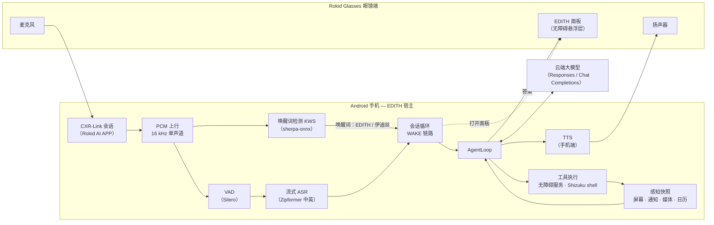
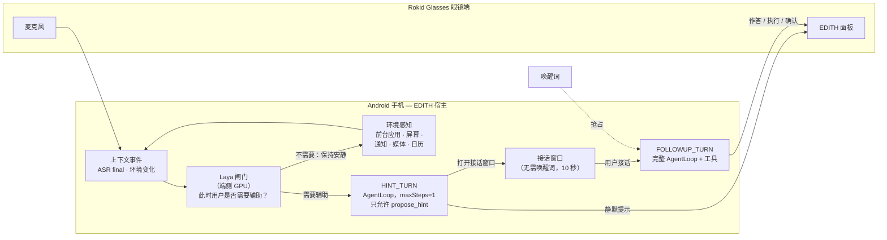

# EDITH（伊迪丝）——运行在 Rokid Glasses 上的全时主动智能 Agent

[English](README.md) | **简体中文**

EDITH（伊迪丝）是一个端云协同的 AI Agent：手机上的 Android 宿主 App + 眼镜端 CustomApp。
眼镜是它的麦克风、扬声器和显示屏，手机是它的耳朵、手、记忆和大脑。眼镜麦克风音频经 Rokid AI
APP 的 CXR-Link 会话上行到手机；手机端侧完成 VAD、ASR 与唤醒词检测，调用你配置的大模型，通过
无障碍服务与 Shizuku 的 shell 操作 Android 应用，最后把答案显示在眼镜 HUD 上，并通过 TTS
经蓝牙音频朗读。

- **唤醒词唤醒**：说“EDITH”或“伊迪丝”。眼镜面板打开，EDITH 识别意图、感知手机（屏幕、通知、
  媒体、日历、设备状态），规划并执行跨应用的多步操作（打开应用/页面、点按、输入中文、滚动、拨号、
  执行 shell），然后在眼镜 HUD 上作答并朗读答案。在 10 秒监听窗口内，后续追问不需要再次唤醒。
- **主动辅助**：点一次「开始」后，EDITH 保持常驻收音与环境感知；端侧小模型（Laya，GPU）判断
  “此时用户是否需要辅助”，需要辅助时**无需唤醒词**、静默地把提示推上眼镜，
  并打开 10 秒接话窗口。你直接接话后，一个完整的 Agent 回合（含工具与确认）随即执行。唤醒词会
  抢占主动接话；两条链路各自维护独立的对话历史。

## 演示视频

| 链路 | 视频 |
| --- | --- |
| 唤醒词唤醒 | [▶ wake-up.mp4](docs/assets/videos/wake-up.mp4) |
| 主动智能辅助 | [▶ proactive.mp4](docs/assets/videos/proactive.mp4) |

## 适配与依赖说明

下表是 EDITH 开发与实测所依据的配置。更新版本的固件或 APP 可能可用，但不在已验证基线内。

| 组件 | 版本 |
| --- | --- |
| Android 手机 | Android 9+（`minSdk 28`）；实测 红米 K40，Android 13 / API 33 |
| Rokid AI APP | `1.14.19.0920`（大陆版，`com.rokid.sprite.aiapp`，versionCode `10140019`） |
| Rokid Glasses | 固件 `1.26.011-20260929-150201`（RG-glasses，Android 12 / API 32，480×640） |
| 眼镜链路 | CXR-Link SDK `client-l 1.1.2` + service bridge `1.0-20260715.121510-107` |
| Shizuku | `13.5.4+`（构建时 API `13.1.5`；设备实测 `13.6.0`） |
| 构建工具链 | JDK 17、Android SDK Platform 35、Gradle wrapper 9.4.1 |

全部端侧模型文件合计约 **1.0 GiB（1.03 GiB）**，放置位置见下文[模型文件](#2-模型文件必需)。

## 技术路线

### 唤醒词唤醒

眼镜麦克风 → CXR 音频流 → PCM 上行 → 唤醒词检测（KWS）→ 手机端 VAD 与流式 ASR → `WAKE`
会话链路 → `AgentLoop` + 云端大模型 → 工具执行与感知 → 答案上屏 + 手机端 TTS。同一条 CXR
会话同时承载显示指令与后续的持续对话音频。



**经过的组件**：Rokid Glasses 麦克风 / HUD / 扬声器 · Rokid AI APP CXR-Link 传输
（`transport-rokid`：会话、音频回调、自定义命令、授权）· PCM 上行 · sherpa-onnx 唤醒词检测
（8 条错相流）· Silero VAD · sherpa-onnx 流式 Zipformer ASR（中英双语，fp32 decoder）·
`plugin-smart-helper`（WAKE 链路、提示词、记忆、技能、工具策略）· `agent-runtime`
（`AgentLoop`、请求装配）· `model-runtime`（Responses / Chat Completions，SSE 流式）·
`host-runtime` / `output-runtime`（输出仲裁、提示编码）· 手机无障碍服务与 Shizuku shell
（工具执行）· Android TTS（经蓝牙输出）。

### 主动辅助

点一次「开始」后会话常驻，环境感知与 CXR 音频流持续运行，环境变化作为事件驱动。轻量端侧闸门
判断此时用户是否需要辅助，不需要调用云端大模型；需要辅助时只产生一个“提示回合”，该回合唯一可用
的工具是 `propose_hint`。用户接话后，才进入完整工具面的 Agent 回合。



**经过的组件**：常驻会话（`SessionService`、CXR 音频、KWS/VAD/ASR）· 感知快照
（`AndroidPerceptionProvider`）· Laya 闸门（`SystemOneService`，端侧 GPU）· HINT_TURN
（`AgentLoop` + 终态工具 `propose_hint`）· `ConversationCycle` 接话窗口 · FOLLOWUP_TURN 复用与
唤醒链路相同的工具面 · 眼镜悬浮面板（经 CXR 自定义命令）。闸门拒绝时**不产生任何模型请求**；
两条链路使用各自独立的 `ConversationStore`。

## 注意事项

### 1. 依赖无障碍服务（必需）

没有 Android 无障碍服务，EDITH 无法读屏，也无法操作其他应用。这里涉及两个服务：

- **手机端** `com.sheen.rokid.phone/.actions.a11y.EdithAccessibilityService`：读屏、语义点按 /
  长按 / 滚动、中文输入、截图。
- **眼镜端** `com.sheen.rokid.glasses/.accessibility.GlassesAccessibilityService`：只提供窗口
  token，让面板以 `TYPE_ACCESSIBILITY_OVERLAY` 画在厂商 HUD 之上（厂商 HUD 是系统窗口，会挡住普通
  应用悬浮窗；无障碍悬浮层的基础 layer 311000 高于 HUD 的 271000）。它不读取窗口内容，也不自己
  绘制任何东西。

两者都用 ADB 开启。**必须先读当前值、再追加**——白名单里可能已有其他应用的服务，不能覆盖。
写进去的设置值不等于服务已绑定，必须在 `dumpsys accessibility` 里确认。

```powershell
$phone   = "<手机序列号>"
$service = "com.sheen.rokid.phone/com.sheen.rokid.phone.actions.a11y.EdithAccessibilityService"

# 先读现值（可能是 null，也可能是冒号分隔的列表），再追加，绝不整体替换。
$old = (adb -s $phone shell settings get secure enabled_accessibility_services).Trim()
$new = if ([string]::IsNullOrWhiteSpace($old) -or $old -eq "null") { $service }
elseif (($old -split ":") -contains $service) { $old }   # 已启用则不重复追加
else { "$old`:$service" }
adb -s $phone shell settings put secure enabled_accessibility_services $new
adb -s $phone shell settings put secure accessibility_enabled 1

# “Bound services” 里必须出现 EDITH 服务；只看到设置值不算生效。
adb -s $phone shell dumpsys accessibility | Select-String "Bound services|EDITH"
```

眼镜端同样操作，组件名换成
`com.sheen.rokid.glasses/com.sheen.rokid.glasses.accessibility.GlassesAccessibilityService`，
序列号换成 `<眼镜序列号>`。

### 2. 模型文件（必需）

**模型文件下载链接**：*（待补充）* <!-- TODO: 发布前填入网盘链接 -->

EDITH 依赖四组端侧模型文件。它们是运行期依赖，不是可选的附加项：智能助手插件把 ASR、SystemOne
（Laya）、Embedding、Perception 声明为必需能力，缺任何一组会导致会话激活失败。

| 模型组 | 内容 | 放置位置 |
| --- | --- | --- |
| ASR 引擎包 | encoder / decoder / joiner（ONNX）、tokens、Silero VAD、声纹模型，外加 `engine-manifest.json` | 手机 App 私有目录 `no_backup/engine-models-import/`，冷启动时导入（debug 构建） |
| 唤醒词（KWS）模型 | sherpa-onnx KWS Zipformer 中英 3M：5 个文件 | 构建机 `.local/p3-kws-model/sherpa-onnx-kws-zipformer-zh-en-3M-2025-12-20/`，构建时打进 APK 的 `assets/kws/` |
| 主动闸门（Laya） | Laya-Multilingual-LiteRT 七件套 | 手机 App 内部 `files/` 目录 |
| 记忆向量模型 | EmbeddingGemma 300M `.tflite` + SentencePiece 词表 | 手机外部目录 `Android/data/com.sheen.rokid.phone/files/models/embeddinggemma/` |

**ASR 引擎包**（整包推入后冷启动 App；`logcat` 应出现 `EdithHost: ENGINE_IMPORTED`）：

```powershell
$phone = "<手机序列号>"
adb -s $phone push <模型目录>/asr /data/local/tmp/edith-asr
adb -s $phone shell "run-as com.sheen.rokid.phone mkdir -p no_backup/engine-models-import"

# 对 engine-manifest.json 以及它声明的每个文件（encoder/decoder/joiner/tokens/vad/speaker）重复：
adb -s $phone shell "cat /data/local/tmp/edith-asr/<文件名> | run-as com.sheen.rokid.phone sh -c 'cat > no_backup/engine-models-import/<文件名>'"

adb -s $phone shell am force-stop com.sheen.rokid.phone   # 然后重新打开一次 App
```

**Laya 闸门**（七个文件放进 App 内部 `files/`）：

```powershell
$phone = "<手机序列号>"
adb -s $phone push <模型目录>/laya /data/local/tmp/edith-laya
adb -s $phone shell "run-as com.sheen.rokid.phone mkdir -p files"

# 对七个文件逐个重复：
adb -s $phone shell "cat /data/local/tmp/edith-laya/<文件名> | run-as com.sheen.rokid.phone sh -c 'cat > files/<文件名>'"
```

**记忆向量模型**：

```powershell
adb -s $phone shell "mkdir -p /sdcard/Android/data/com.sheen.rokid.phone/files/models"
adb -s $phone push <模型目录>/embeddinggemma /sdcard/Android/data/com.sheen.rokid.phone/files/models/
```

**KWS 模型**：Gradle 构建从上面的 `.local/...` 路径读取这五个文件、校验 SHA-256 后连同仓库内的
`keywords.txt` 一起打包为 `assets/kws/`。该目录缺失时构建仍会成功，但 APK 内没有唤醒词模型，
App 会报告 `KWS_MODEL_MISSING`。

模型文件遵循各自上游许可证（按模型组分别为 Apache-2.0 / MIT / Gemma 条款），不随本仓库分发。

### 3. 眼镜端要用 ADB 开启的权限

眼镜端 App 是侧载 CustomApp。先用 ADB 安装，再授予它需要的两个特殊权限：

```powershell
$glasses = "<眼镜序列号>"

# 1) 安装 / 更新眼镜端 APK（例如 .\glasses-app\app\build\outputs\apk\debug\app-debug.apk）。
adb -s $glasses install -r <眼镜端APK>

# 2) 悬浮窗权限：常驻面板是画在其他应用之上的 TYPE_APPLICATION_OVERLAY 窗口。
adb -s $glasses shell appops set com.sheen.rokid.glasses SYSTEM_ALERT_WINDOW allow
adb -s $glasses shell appops get com.sheen.rokid.glasses SYSTEM_ALERT_WINDOW     # 期望输出 allow

# 3) 无障碍服务：提供窗口 token，把面板以 TYPE_ACCESSIBILITY_OVERLAY 画到厂商 HUD 之上。
$component = "com.sheen.rokid.glasses/com.sheen.rokid.glasses.accessibility.GlassesAccessibilityService"
$old = (adb -s $glasses shell settings get secure enabled_accessibility_services).Trim()
$new = if ([string]::IsNullOrWhiteSpace($old) -or $old -eq "null") { $component }
elseif (($old -split ":") -contains $component) { $old }   # 已启用则不重复追加
else { "$old`:$component" }
adb -s $glasses shell settings put secure enabled_accessibility_services $new
adb -s $glasses shell settings put secure accessibility_enabled 1
adb -s $glasses shell dumpsys accessibility | Select-String "Bound services|EDITH"
```

面板需要的唤醒锁、前台服务权限属于普通安装期权限，不需要 ADB 单独授予。每次重装眼镜端 APK 后
都要复查悬浮窗 app-op 与无障碍条目，平台可能把它们重置。

### 4. 眼镜端 App 依赖 Rokid 开发线安装应用与 ADB 开权限

眼镜是消费级设备，没有给第三方 CustomApp 的应用商店。安装 EDITH 眼镜端 App 必须使用
**Rokid 开发线**（眼镜开启 USB 调试 / 开发者访问），再按上面的 `adb install` 侧载；上面那些特殊
权限也只能通过 ADB 授予。手机侧则需要安装、登录 Rokid AI APP 并与眼镜完成配对；EDITH 第一次
建立会话时，AI APP 会请求 CXR 会话授权（麦克风等权限），需要点击允许。

### 5. 手机端设置

- **Shizuku**：安装 Shizuku 13.5.4+，按其官方方式启动服务（root 或 ADB），然后在 Shizuku 中
  授权 EDITH。它提供 `shell` / `open` / 特权命令背后的 shell-UID 通道；未授权时这些工具降级，
  无障碍类工具仍可工作。
- **通知使用权**：授予通知监听权限，EDITH 才能感知通知内容。
- **悬浮窗**：授予“显示在其他应用上层”（`SYSTEM_ALERT_WINDOW`），确认弹窗才能浮在其他应用
  之上。缺权限时对应通道按降级处理，不会静默扩大权限。
- **运行时权限**：通知、拨号（`dial`）、日历（日程感知）；若使用 `/sdcard/EDITH/skills` 技能库，
  还需要「所有文件访问」权限。
- **可选的锁屏自动解锁**：在 **设置 → 锁屏自动解锁** 里配置 4–16 位数字 PIN。PIN 只保存在本机，
  用 Android Keystore AES/GCM 加密，只在会话运行期间供设备类工具通过锁屏使用。图案锁和非 ASCII
  密码不受支持，会明确拒绝而不是半支持。

## 许可证

EDITH 采用 **Apache License 2.0** 许可。完整文本见 [LICENSE](LICENSE)。
第三方组件（厂商 SDK、模型文件等）遵循各自许可证。

