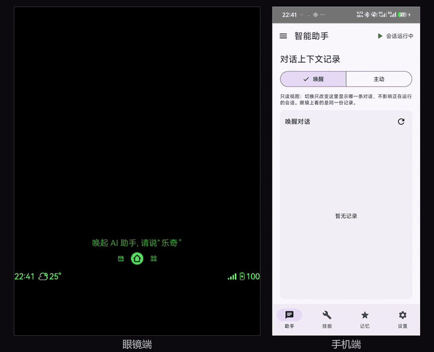
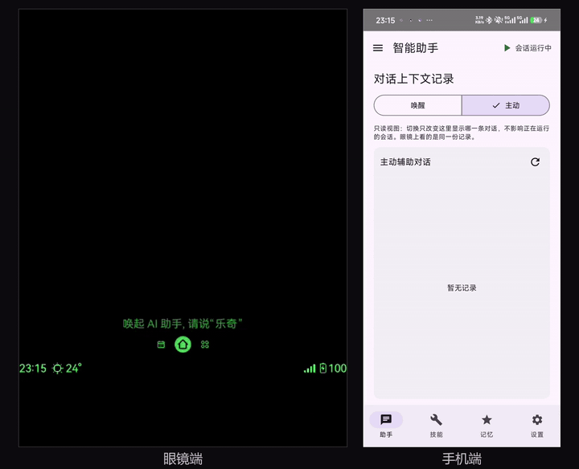
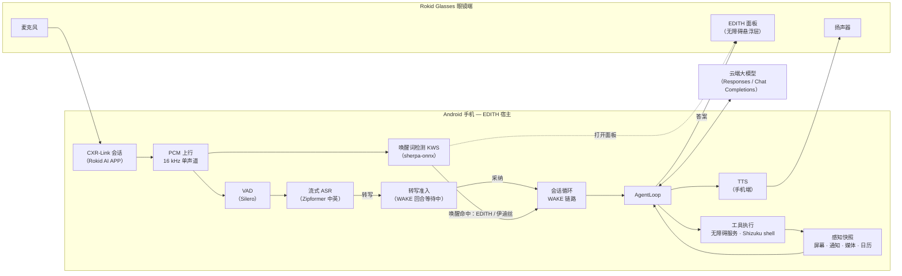
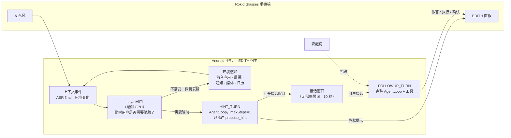
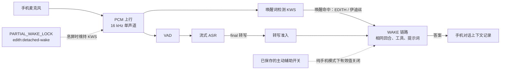

<div align="center">
  <picture>
    
  </picture>
</div>

<h3 align="center">
EDITH（伊迪丝）：运行在安卓端、连接 Rokid Glasses 的全时主动智能 Agent
</h3>

<p align="center">
  | <a href="#演示视频"><b>演示视频</b></a> |
  <a href="#技术路线"><b>技术路线</b></a> |
  <a href="#项目结构"><b>项目结构</b></a> |
  <a href="#注意事项"><b>注意事项</b></a> |
  <a href="LICENSE"><b>Apache-2.0</b></a> |
</p>

<p align="center">
  <a href="README.md">English</a> | <strong>简体中文</strong>
</p>

> **预览版状态**：EDITH 目前处于预览版阶段（版本 `0.5.0-preview`），功能可用，但性能、稳定性与整体体验仍需持续优化。

EDITH（伊迪丝）是一个端云协同的 AI Agent：手机上的 Android 宿主 App + 眼镜端 CustomApp。
眼镜是它的麦克风、扬声器和显示屏，手机是它的耳朵、手、记忆和大脑。眼镜麦克风音频经 Rokid AI
APP 的 CXR-Link 会话上行到手机；手机端侧完成 VAD、ASR 与唤醒词检测，调用你配置的大模型，通过
无障碍服务与 Shizuku 的 shell 操作 Android 应用，通过眼镜 HUD 文字显示与TTS音频与用户交流。
0.4 起，手机也可以以**纯手机模式**运行，改用自己的麦克风和屏幕；0.5 起桌面还会出现 EDITH 图标
悬浮球，长按说话、用半透明消息气泡显示回复与过程提示；手机「对话上下文记录」页继续提供文字与语音输入。

- **纯手机模式**：设置里打开「纯手机模式」后，桌面出现可拖动的 EDITH 图标悬浮球；拖到边框
  自动吸附并隐藏一半；长按球内出现麦克风并进入 ASR，识别结果直接发给 Agent;悬浮球与气泡的透明度都可调；
  纯手机模式下
  回答后**不再自动续聊 10s**，下一句长按悬浮球手动说。

- **唤醒词唤醒**：说“EDITH”或“伊迪丝”。眼镜面板打开，EDITH 识别意图、感知手机（屏幕、通知、
  媒体、日历、设备状态），规划并执行跨应用的多步操作（打开应用/页面、点按、输入中文、滚动、拨号、
  执行 shell），然后在眼镜 HUD 上作答并朗读答案。在 10 秒监听窗口内，后续追问不需要再次唤醒。
- **主动辅助**：点一次「开始」后，EDITH 保持常驻收音与环境感知；端侧小模型（Laya，GPU）判断
  “此时用户是否需要辅助”，需要辅助时**无需唤醒词**、静默地把提示推上眼镜，并打开 10 秒接话窗口。
  接话后，一个完整的 Agent 回合随即执行。

## 演示视频

**唤醒词唤醒**——说“EDITH”或“伊迪丝”，面板打开并由 EDITH 执行请求。

<div align="center">
  <a href="docs/assets/videos/wake-up.mp4">
    
  </a>
</div>

**主动辅助**——EDITH 感知上下文后主动给出提示，接话后继续执行。

<div align="center">
  <a href="docs/assets/videos/proactive.mp4">
    
  </a>
</div>

**纯手机模式（0.4 起；0.5 加入悬浮球/气泡，0.5.1 更名）**——不依赖眼镜链路，支持唤醒词唤醒与悬浮球长按说话。

<div align="center">
  <a href="docs/assets/videos/detached-wake.mp4">
    
  </a>
</div>

> 说明：视频有**加速**，实际执行约**一分多钟**。

## 适配与依赖说明

下表是 EDITH 开发与实测所依据的配置。更新版本的固件或 APP 可能可用，但不在已验证基线内。

| 组件 | 版本 |
| --- | --- |
| Android 手机 | Android 9+（`minSdk 28`）；实测 红米 K40，Android 13 / API 33 |
| Rokid AI APP | `1.14.19.0920`（大陆版，`com.rokid.sprite.aiapp`，versionCode `10140019`） |
| Rokid Glasses | 固件 `1.26.011-20260929-150201`（RG-glasses，Android 12 / API 32，480×640） |
| 眼镜链路 | CXR-Link SDK `client-l 1.1.2` + service bridge `1.0-20260715.121510-107` |
| Shizuku | `13.5.4+`（构建时 API `13.1.5`；设备实测 `13.6.0`） |
| 构建工具链 | JDK 17、Android SDK Platform 35、Gradle wrapper 9.4.1 |

四组端侧模型全部内置在手机 APK 中（约 **1.1 GB**）；首次启动会准备约 **1.0 GiB（1.03 GiB）**。
运行期位置见下文[模型文件](#2-模型文件已内置)。

## 技术路线

0.4 保留原有两条链路，并新增三块能力：只依赖手机的「纯手机模式」唤醒变体、手机端文字/听写输入行，
以及从 APK 资产准备模型。0.5 在纯手机模式上增加桌面悬浮球、独立消息气泡。
默认眼镜配置与下面描述的链路不变。

### 唤醒词唤醒

眼镜麦克风 → CXR 音频流 → PCM 上行。同一路 PCM 同时送给两个消费者：唤醒词检测（KWS）与
VAD + 流式 ASR。KWS 命中“EDITH / 伊迪丝”后产生唤醒事件、拉起眼镜面板并打开 WAKE 回合；
VAD/ASR 从会话开始就持续工作（不能等唤醒才启动：唤醒词通常在句首，等唤醒会丢句首音频；主动辅助
链路本来就没有唤醒词），但只有 WAKE 回合处于等待转写状态时，final 转写才会被采纳并进入
`AgentLoop`——没有回合等待时，final 不会凭空打开唤醒回合，而是进入主动辅助触发路径。
`AgentLoop` + 云端大模型 → 工具执行与感知 → 答案上屏 + 手机端 TTS。同一条 CXR 会话同时承载
显示指令与后续的持续对话音频。打开「纯手机模式」后，这条链路改从手机麦克风起头，不再经过 CXR
上行；其后的 KWS、VAD、ASR 与转写准入之后的处理完全相同（见下文）。纯手机模式还支持**锁屏/息屏唤醒**
（前台服务 + `PARTIAL_WAKE_LOCK`），并对每次被接受的唤醒在**回声静默窗口**内播固定确认「我在」：
窗口内麦克风帧置静音，确认音不会进入 ASR，也不会污染用户随后指令的识别；WAKE 回合不等待确认播完，
零新增延迟。



**经过的组件**：Rokid Glasses 麦克风 / HUD / 扬声器 · Rokid AI APP CXR-Link 传输
（`transport-rokid`：会话、音频回调、自定义命令、授权）· PCM 上行 · sherpa-onnx 唤醒词检测
（8 条错相流）· Silero VAD · sherpa-onnx 流式 Zipformer ASR（中英双语，fp32 decoder）·
`plugin-smart-helper`（WAKE 链路、提示词、记忆、技能、工具策略）· `agent-runtime`
（`AgentLoop`、请求装配）· `model-runtime`（Responses / Chat Completions，SSE 流式）·
`host-runtime` / `output-runtime`（输出仲裁、提示编码）· 手机无障碍服务与 Shizuku shell
（工具执行）· Android TTS（经蓝牙输出）。

### 主动辅助

点一次「开始」后会话常驻，环境感知与 CXR 音频流持续运行，环境变化作为事件驱动。轻量端侧闸门
判断此时用户是否需要辅助，不需要调用云端大模型；需要辅助时只产生一个“提示回合”，该回合唯一可用
的工具是 `propose_hint`。用户接话后，才进入完整工具面的 Agent 回合。



**经过的组件**：常驻会话（`SessionService`、CXR 音频、KWS/VAD/ASR）· 感知快照
（`AndroidPerceptionProvider`）· Laya 闸门（`SystemOneService`，端侧 GPU）· HINT_TURN
（`AgentLoop` + 终态工具 `propose_hint`）· `ConversationCycle` 接话窗口 · FOLLOWUP_TURN 复用与
唤醒链路相同的工具面 · 眼镜悬浮面板（经 CXR 自定义命令）。闸门拒绝时**不产生任何模型请求**；
两条链路使用各自独立的 `ConversationStore`。

### 纯手机模式（0.4 起；0.5 加入悬浮球/气泡，0.5.1 更名并更正）

「纯手机模式」设置让唤醒链路不依赖眼镜。0.5 起，开启后桌面会出现 EDITH 图标悬浮球：可拖动、吸附
左右边框并隐藏一半；长按球内显示麦克风并进入 ASR，识别结果直接发给 Agent；AI 回复与工具调用以
独立半透明消息气泡显示（工具信息与眼镜端一致，最多 2 条，整泡随透明度滑块变淡），旧消息淡化后 2s 消失；
AI 思考时球外显示动态光影线条；悬浮球与气泡的透明度可在设置中分别调整。纯手机模式下「语音朗读」修复后，
最终回答会在开关打开时朗读（眼镜模式保持 HUD 显示）；开关运行中即时生效、关闭即停，无需重启 App。
回答后不再自动开 10s 续聊窗口，下一句长按悬浮球说。0.5.1 更正是 checkpoint：JVM/设备读数与剩余
`NotMeasured` 项见 [0.5.1 证据](docs/project/evidence/2026-10-29-0.5.1-correction.md)。



关闭该开关时，上面的眼镜链路保持不变：CXR 连接、眼镜唤醒、面板显示与接话语义都不变。纯手机模式
只是本机采音/显示选择，不是第二套 CXR 协议。

## 项目结构

- `phone-app/` — Android 手机宿主：会话与插件宿主、感知、语音、模型运行时、原生动作通道（无障碍 / Shizuku）
- `glasses-app/` — 眼镜端 CustomApp：CXR-S 桥接、悬浮面板与渲染
- `common/` — 两端共用的契约与展示 / 输出模块
- `tools/` — 探针、评测装置与脚本（非交付）
- `third_party/` — vendored 构建输入（如 CXR SDK）
- `docs/` — 项目文档、证据、品牌与演示资源

## 注意事项

### 1. 依赖无障碍服务（必需）

没有 Android 无障碍服务，EDITH 无法读屏，也无法操作其他应用。这里涉及两个服务：

- **手机端** `com.sheen.rokid.phone/.actions.a11y.EdithAccessibilityService`：读屏、语义点按 /
  长按 / 滚动、中文输入、截图。
- **眼镜端** `com.sheen.rokid.glasses/.accessibility.GlassesAccessibilityService`：只提供窗口
  token，让面板以 `TYPE_ACCESSIBILITY_OVERLAY` 画在厂商 HUD 之上（厂商 HUD 是系统窗口，会挡住普通
  应用悬浮窗；无障碍悬浮层的基础 layer 311000 高于 HUD 的 271000）。它不读取窗口内容，也不自己
  绘制任何东西。

两者都用 ADB 开启。**必须先读当前值、再追加**——白名单里可能已有其他应用的服务，不能覆盖。
写进去的设置值不等于服务已绑定，必须在 `dumpsys accessibility` 里确认。

```powershell
$phone   = "<手机序列号>"
$service = "com.sheen.rokid.phone/com.sheen.rokid.phone.actions.a11y.EdithAccessibilityService"

# 先读现值（可能是 null，也可能是冒号分隔的列表），再追加，绝不整体替换。
$old = (adb -s $phone shell settings get secure enabled_accessibility_services).Trim()
$new = if ([string]::IsNullOrWhiteSpace($old) -or $old -eq "null") { $service }
elseif (($old -split ":") -contains $service) { $old }   # 已启用则不重复追加
else { "$old`:$service" }
adb -s $phone shell settings put secure enabled_accessibility_services $new
adb -s $phone shell settings put secure accessibility_enabled 1

# “Bound services” 里必须出现 EDITH 服务；只看到设置值不算生效。
adb -s $phone shell dumpsys accessibility | Select-String "Bound services|EDITH"
```

眼镜端同样操作，组件名换成
`com.sheen.rokid.glasses/com.sheen.rokid.glasses.accessibility.GlassesAccessibilityService`，
序列号换成 `<眼镜序列号>`。

### 2. 模型文件（已内置）

四组端侧模型——ASR 引擎包、唤醒词（KWS）、主动闸门（Laya）与记忆向量（EmbeddingGemma）——全部
**内置在手机 APK 中**。用户不需要另外从夸克网盘下载，也不需要 `adb push` 才能安装或开始使用 EDITH。

完整 APK 约 **1.1 GB**（实测 debug 构建：1.11 GB / 1.0347 GiB）。安装时建议预留约 **2.2 GB**
空闲空间（估算：APK 加准备后的副本）。四组模型准备后合计约 **1.0 GiB（1.03 GiB）**。在验收设备
K40 的 debug 构建上，首次准备约 **12.8 s**，之后冷启动复用已有副本约 **0.45 s**
（均为 2026-10-26 设备实测；release 未测）。
准备完成前，App 显示准备本地模型状态，并拒绝以半套模型启动会话。

| 模型组 | 内容 | 准备后的运行期位置 |
| --- | --- | --- |
| ASR 引擎包 | encoder / decoder / joiner（ONNX）、tokens、Silero VAD、声纹模型，外加 `engine-manifest.json` | 手机 App 私有目录 `no_backup/engine-models/` |
| 唤醒词（KWS）模型 | sherpa-onnx KWS Zipformer 中英 3M：5 个运行期文件 + `keywords.txt` | APK 资产 `assets/kws/`（原地读取，不单独复制） |
| 主动闸门（Laya） | Laya-Multilingual-LiteRT：6 个运行期文件 | 手机 App 内部 `files/`（6 个文件 + bundle receipt） |
| 记忆向量模型 | EmbeddingGemma 300M `.tflite` + SentencePiece 词表 | 手机外部目录 `Android/data/com.sheen.rokid.phone/files/models/embeddinggemma/`（内部回退） |

构建期会逐个校验文件 bytes/SHA-256 必须与 `tools/scripts/p2/model-bundles.json` 一致，缺失或不
一致会构建失败；同时从固定条目派生 bundle id，声明值不匹配即失败，因此文件摘要变化必然改变
receipt。15 份许可证/声明文本随包放在 `assets/models/licenses/`。首次启动以及 APK 更新后
bundle 变化时，App 会重新校验并准备 asset；bundle 未变化时复用已有副本。

**开发构建**

模型二进制不提交仓库。要构建完整 APK，先准备 staging 目录，再用 `-PbundledModelsDir` 指定：

```powershell
.\gradlew.bat :phone-app:app:assembleDebug -PbundledModelsDir=D:\Project_new\EDITH_model\k40
```

默认目录是 `<仓库>/../EDITH_model/k40`（K40 模型包），下面放 `engine-models-import/`、`files/` 与
`embeddinggemma/`；KWS 模型放 `kws/`，仓库内 `keywords.txt` 仍在
`phone-app/perception/audio-android/kws/`。完整构建要求每个文件都存在且校验通过；缺失或不一致会构建失败。

仅开发/CI 可使用 `-PwithoutBundledModels=true` 跳过 `assets/models/**` 并设置
`BuildConfig.BUNDLED_MODELS=false`。**release 变体会拒绝该开关**，它绝不能产出交付 APK。

模型文件遵循各自上游许可证（ASR/KWS/Laya 为 Apache-2.0，Silero 为 MIT，EmbeddingGemma 为
Gemma 条款），不随本仓库分发。固定来源/revision 与保留的许可证/声明文本见
`tools/scripts/p2/NOTICE.md` 与 `tools/scripts/p2/licenses/`；`distributionReview` 仍为 Incomplete。

### 3. 眼镜端要用 ADB 开启的权限

眼镜端 App 是侧载 CustomApp。先用 ADB 安装，再授予它需要的两个特殊权限：

```powershell
$glasses = "<眼镜序列号>"

# 1) 安装 / 更新眼镜端 APK（例如 .\glasses-app\app\build\outputs\apk\debug\app-debug.apk）。
adb -s $glasses install -r <眼镜端APK>

# 2) 悬浮窗权限：常驻面板是画在其他应用之上的 TYPE_APPLICATION_OVERLAY 窗口。
adb -s $glasses shell appops set com.sheen.rokid.glasses SYSTEM_ALERT_WINDOW allow
adb -s $glasses shell appops get com.sheen.rokid.glasses SYSTEM_ALERT_WINDOW     # 期望输出 allow

# 3) 无障碍服务：提供窗口 token，把面板以 TYPE_ACCESSIBILITY_OVERLAY 画到厂商 HUD 之上。
$component = "com.sheen.rokid.glasses/com.sheen.rokid.glasses.accessibility.GlassesAccessibilityService"
$old = (adb -s $glasses shell settings get secure enabled_accessibility_services).Trim()
$new = if ([string]::IsNullOrWhiteSpace($old) -or $old -eq "null") { $component }
elseif (($old -split ":") -contains $component) { $old }   # 已启用则不重复追加
else { "$old`:$component" }
adb -s $glasses shell settings put secure enabled_accessibility_services $new
adb -s $glasses shell settings put secure accessibility_enabled 1
adb -s $glasses shell dumpsys accessibility | Select-String "Bound services|EDITH"
```

面板需要的唤醒锁、前台服务权限属于普通安装期权限，不需要 ADB 单独授予。每次重装眼镜端 APK 后
都要复查悬浮窗 app-op 与无障碍条目，平台可能把它们重置。

### 4. 眼镜端 App 依赖 Rokid 开发线安装应用与 ADB 开权限

眼镜是消费级设备，没有给第三方 CustomApp 的应用商店。安装 EDITH 眼镜端 App 必须使用
**Rokid 开发线**（眼镜开启 USB 调试 / 开发者访问），再按上面的 `adb install` 侧载；上面那些特殊
权限也只能通过 ADB 授予。手机侧则需要安装、登录 Rokid AI APP 并与眼镜完成配对；EDITH 第一次
建立会话时，AI APP 会请求 CXR 会话授权（麦克风等权限），需要点击允许。

### 5. 手机端设置

- **Shizuku**：安装 Shizuku 13.5.4+，按其官方方式启动服务（root 或 ADB），然后在 Shizuku 中
  授权 EDITH。它提供 `shell` / `open` / 特权命令背后的 shell-UID 通道；未授权时这些工具降级，
  无障碍类工具仍可工作。
- **通知使用权**：授予通知监听权限，EDITH 才能感知通知内容。
- **悬浮窗**：授予“显示在其他应用上层”（`SYSTEM_ALERT_WINDOW`），确认弹窗才能浮在其他应用
  之上。缺权限时对应通道按降级处理，不会静默扩大权限。
- **运行时权限**：通知、拨号（`dial`）、日历（日程感知）；若使用 `/sdcard/EDITH/skills` 技能库，
  还需要「所有文件访问」权限。
- **可选的锁屏自动解锁**：在 **设置 → 锁屏自动解锁** 里配置 4–16 位数字 PIN。PIN 只保存在本机，
  用 Android Keystore AES/GCM 加密，只在会话运行期间供设备类工具通过锁屏使用。图案锁和非 ASCII
  密码不受支持，会明确拒绝而不是半支持。

## 许可证

EDITH 采用 **Apache License 2.0** 许可。完整文本见 [LICENSE](LICENSE)。
第三方组件（厂商 SDK、模型文件等）遵循各自许可证。

