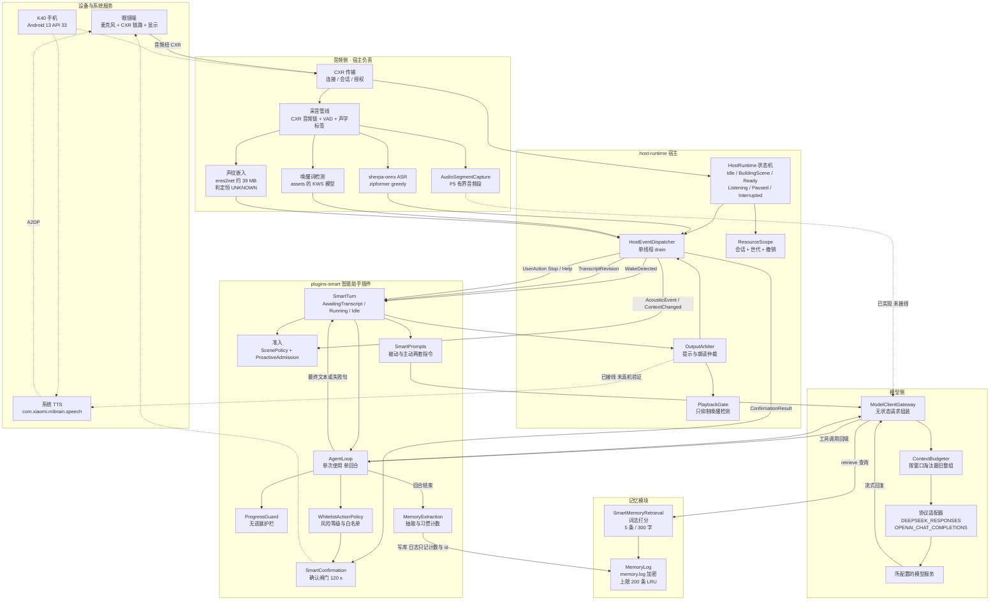
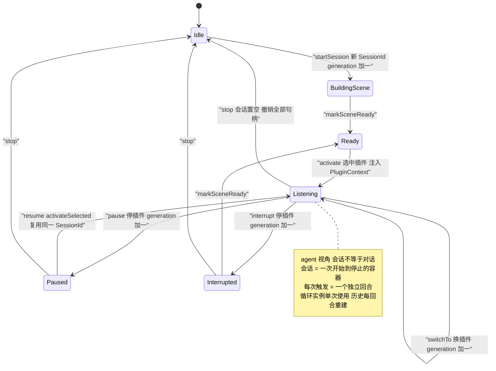
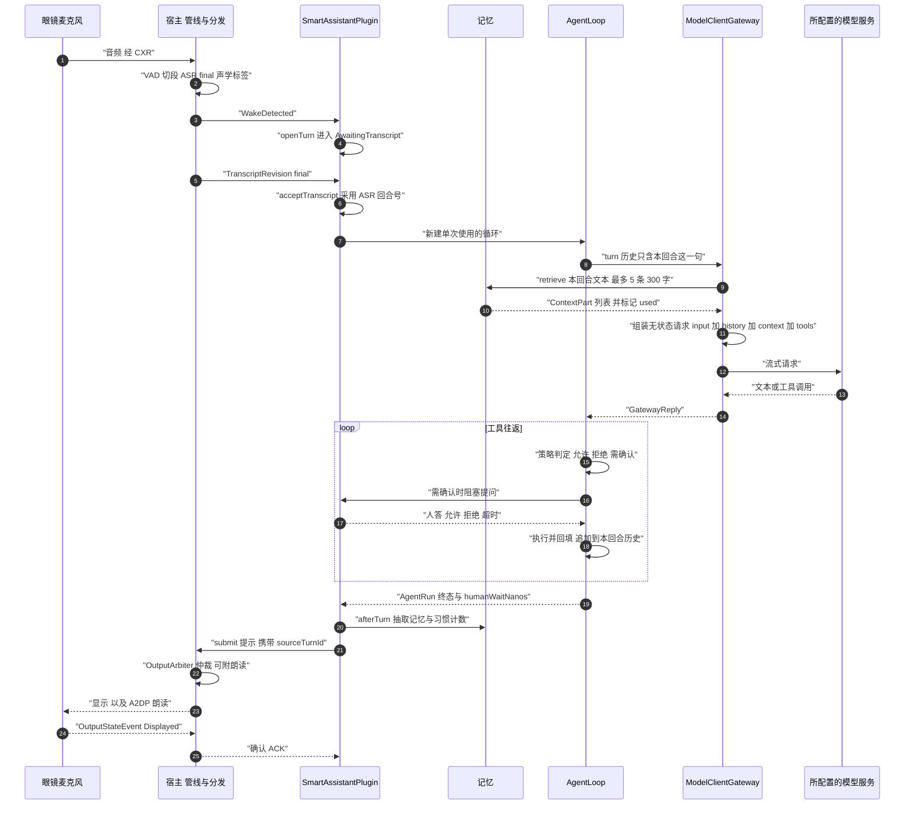
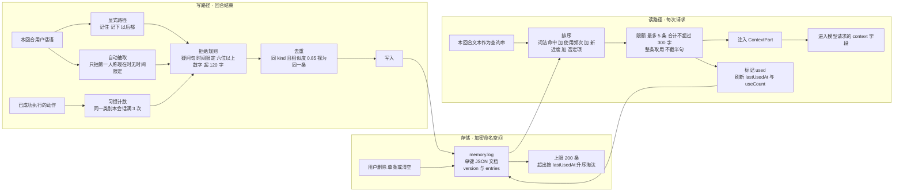

# 会话管理与记忆模块：全链路图（会话记录 / 非测量）

- **日期**：2026-10-13
- **性质**：**源码事实的记录**，由一次只读核对产出。**本轮零代码改动、零契约改动、未跑回归、未上设备。**
- **用途**：交接与讨论的共同底图。回答"会话怎么管、触发一次是不是一次会话、记忆在哪一环"。
- **代码基线**：本文件落盘时的 **HEAD ＝ `fccbba2`**（`docs(p5): checkpoint p5-exec-20261012-06 — reviewer fix pass complete`），分支 `main`。
  ⚠️ **一处与旧记录的差异（如实记）**：`PROJECT_STATE.md` 的 `p5-exec-20261012-03` 条目写的 HEAD 是 `f92385d`，而实际 HEAD 已前进到 `fccbba2` ⇒ **该状态条目相对仓库已陈旧**（本文件的图与引用以**当前工作树源码**为准）。本文件不改 `PROJECT_STATE`，该 drift 留待记录同步时一并处理。
- **证据强度**：图中每一条边都在 §5 标了状态（已接线 / 已实现未接线 / 未实现）以及源码位置；**没有一条是推测**。
- **不改变任何既有结论**：`P3.5-C` 的 `NotMet`、`D55`/`D56`/`D57`/`D58` 均不受影响。

---

## 1. 图 1：全链路总览

**这张图要说的三件事**

1. **会话的"容器"在宿主，对话的"内容"在插件，而两者寿命不同**：容器（`SessionId`/`Generation`/`ResourceScope`）活到用户点停止；内容（回合历史）每次触发重建、结束即丢。详见 §2、§3。
2. **记忆是唯一跨回合的通道**：`MemoryLog → SmartMemoryRetrieval → ModelClientGateway` 这条回到模型请求的线，是唯一能让上一回合影响下一回合的路径，受 200 条 / 5 条 / 300 字三重约束。
3. **P5 的两条链路尚未闭环**（图中点线）：音频进模型无生产者；朗读出眼镜未真机验证。**不得把"已实现"读成"已可用"。**

---

## 2. 图 2：会话生命周期与世代

**事实与位置**

| 事实 | 位置 |
|---|---|
| 状态取值与迁移 | `host-runtime/src/main/kotlin/edith/host/HostRuntime.kt:155-269`（`startSession` / `markSceneReady` / `activate` / `pause` / `resume` / `switchTo` / `stop` / `interrupt`） |
| 事件按 `sessionId + generation` 过滤 | 同上 `:311`（`isCurrent`）；插件侧同一规则 `plugins-smart/.../SmartAssistantPlugin.kt:550-553`（`matches`） |
| 停止/暂停/切换都会撤销句柄 | `ResourceScope`：`host-runtime/src/main/kotlin/edith/host/ResourceScope.kt`（`checkActive` / `revoke`） |
| `Listening` 自环＝同一会话内多次触发、世代不变 | `startSession` 才 `generation + 1`；一次触发不碰 `generation` |
| 换会话会清空插件侧残留 | `SmartAssistantPlugin.kt:412-419`（`lastFinalTranscript` / `lastFinalTurnId` / 感知状态在 `activate` 时清零） |

**关键结论**：`SessionId` 是**信封与权限作用域**（相关性过滤、句柄撤销、上传许可的口径），**不是对话存储**。所以"一次会话"和"一次对话"在代码里是两件事。

---

## 3. 图 3：单回合时序（被动路径）

**事实与位置**

| 事实 | 位置 |
|---|---|
| 回合历史**只以本回合话语开头**，无跨回合上下文 | `agent-runtime/src/main/kotlin/edith/agent/AgentLoop.kt:190-191` |
| 循环**单次使用**，一实例只服务一个回合 | 同上 `:180-184`（`check(!started)` + KDoc `:106-108`）；插件每回合新建 `buildLoop`（`SmartAssistantPlugin.kt:866-893`） |
| 工具往返追加进**本回合**历史 | `AgentLoop.kt:261-269`（echo 调用）、`:349`（回填输出） |
| 历史在回合结束时丢弃 | 只有 `lastTranscript` 留存，且是 `internal`、给测试看（`AgentLoop.kt:145,379`）；`SmartTurn` 明说不持有可复用的对话状态（`SmartTurn.kt:24-27`） |
| 请求组装为**无状态**：`input`＝在飞用户回合，`history`＝本回合之前的部分 | `agent-runtime/.../ModelClientGateway.kt:166-209`（`split`）；契约 `plugin-api/src/main/kotlin/edith/plugin/ModelServices.kt:112-136` |
| 记忆检索在**每次请求**时按本回合文本发起 | `ModelClientGateway.kt:186-198`（`memoryFor`）；上限常量 `MEMORY_RETRIEVAL_LIMIT` 见同一文件 `:36` |
| 记忆写入在回合结束之后 | `SmartAssistantPlugin.kt:848`（`rememberFromTurn`）→ `MemoryExtraction.afterTurn`（`MemoryExtraction.kt:30`） |
| 人在确认上花的时间不计入回合预算 | `AgentLoop.kt:299-314`（`D49`）；`AgentRun.humanWaitNanos` `:56-62` |

**关键结论**：一次触发＝**一个自包含回合**（`AgentRequest` → 单次使用 `AgentLoop` → `AgentRun`）。回合内可以有多轮工具往返，但**回合之间没有任何对话记录传递**——这就是"不具备连续对话能力"的全链路依据。

---

## 4. 记忆模块：两条路径与三重上限

**三重上限（都在本图里，是召回收益的硬边界）**

| 上限 | 数值 | 位置 |
|---|---|---|
| 库容量 | 200 条，超出按 LRU 淘汰 | `plugins-smart/.../memory/MemoryLog.kt:188`（`CAP`）、`MemoryModel.kt:147-156`（`evict`） |
| 每次注入条数 | 5 条 | `plugins-smart/.../memory/SmartMemoryRetrieval.kt:64`（`INJECT_LIMIT`）；网关侧 `ModelClientGateway.kt:36` |
| 每次注入字符 | 合计 300 字（**整条取用，超预算即停，不截半句**） | `SmartMemoryRetrieval.kt:67`（`CHAR_BUDGET`）、`MemoryModel.kt:129-137` |
| 单条长度 | ≤120 字（抽取阶段就拒绝超长，不截断） | `MemoryModel.kt:29`（`MEMORY_MAX_CHARS`）、`:174-184` |
| 每回合写入条数 | ≤5 条 | `MemoryExtraction.kt:76`（`MAX_PER_TURN`） |

**两条路径的共同落点**：无论显式还是自动，都要穿过同一套拒绝规则（疑问句 / 时间限定 / 六位以上数字形态 / 超长），再经 0.85 相似度去重，才进文档。这条顺序是隐私口径的实现，不是可选优化。

---

## 5. 边状态明细（本文件的核心交付）

### 5.1 已接线（生产路径上真实存在）

| 边 | 位置 |
|---|---|
| 宿主采音管线 → VAD / ASR / 唤醒 / 声学标签 | `phone-app/src/main/kotlin/edith/phone/HostCompositionRoot.kt`（管线装配）；引擎 `audio-android/src/main/kotlin/edith/audio/android/SherpaNativeOwners.kt:31`、`SherpaNativeConfiguration.kt:11-23` |
| ASR / 唤醒 / 感知 → 事件分发 → 插件 | `HostRuntime.deliverEvent`；插件 `SmartAssistantPlugin.kt:500-546` |
| 回合 → 循环 → 网关 → 预算器 → 适配器 | `SmartAssistantPlugin.kt:867-893`、`AgentLoop.kt`、`ModelClientGateway.kt:80-139`、`model-runtime/.../ContextBudgeter.kt:9`、`DeepSeekResponsesAdapter.kt` / `OpenAiChatCompletionsAdapter.kt` |
| 记忆检索 → 注入请求 | `ModelClientGateway.kt:96-98,186-198`；实现 `SmartMemoryRetrieval.kt:32-57` |
| 回合结束 → 记忆写入 | `SmartAssistantPlugin.kt:848,859-864`；`MemoryExtraction.kt:30-57`；`MemoryLog.record` `:76-96` |
| 提示提交 → 仲裁 → 显示 | `SmartAssistantPlugin.submitOutcome` / `emit`；`host-runtime/.../OutputArbiter.kt` |
| 确认闸门 → 手机侧多通道 | `SmartConfirmation`（`SmartAssistantPlugin.kt:267-270`，窗口 120 s `SmartConfirmation.kt:186`）；手机侧 `ConfirmationNotifications.kt:101` 与主屏弹窗 |
| 音频采集 → `AudioSegmentCapture` | `HostCompositionRoot.kt:1350`（`AudioSegmentBridge`）、`:1994-2006`（帧信号喂入，缺段时 `offer(pcmBytes, speech)`） |

### 5.2 已实现但**未接线**（图上的点线）

| 边 | 现状 | 位置 |
|---|---|---|
| `AudioSegmentCapture → ModelClientGateway.audioParts` | 端口与采集都在，**插件侧没有调用点**把音频段放进请求 ⇒ `InputPart.Audio` 在生产里**没有生产者** | 端口 `ModelClientGateway.kt:71-77,96`；采集 `phone-app/.../AudioSegmentCapture.kt:47`；桥 `phone-app/.../AudioSegmentBridge.kt`；**调用点检索为空** |
| `OutputArbiter → 系统 TTS` | 播放器已实现并已装配，但 `CxrHostEnvironment.speech` 当前为 `null`，且**未真机验证"声音真的走眼镜"** | `phone-app/.../AndroidSpeechPlayer.kt:70-88`；装配 `HostCompositionRoot.kt:1464-1468`；为 `null` 处 `CxrHostEnvironment.kt:63`；口径 `D58`（沿用 K70 的 A2DP 证据，**不得读成已在 K40 验证**） |
| `PlaybackGate → 唤醒检测`（且**不**抑制 ASR 摄入） | 按设计只抑制唤醒检测器 | `HostCompositionRoot.kt:1323,1582` |
| 主动路径的记忆检索 | 已接线（走同一条 `memoryRetrieval`） | `SmartAssistantPlugin.kt:1000-1016` |

### 5.3 已实现但**生产无调用者**

| 组件 | 现状 |
|---|---|
| `ContextPlanner`（跨回合降级规划：摘要化 / 丢中间产物 / 按整组截断并带 `noteToModel`） | 只有测试调用；生产里没有任何装配点（与 `P3.4-NM` 记的"planner 未接线"同源） |
| `MemoryRetrieval` 接口的**其它**实现 | 只有插件侧 `SmartMemoryRetrieval` 一个实现 |

### 5.4 未实现（本版不存在）

| 能力 | 现状 |
|---|---|
| **会话级对话记录（跨回合保存上文）** | **不存在**。每次触发只发本回合话语（`AgentLoop.kt:190-191`）；宿主不持有对话存储 |
| 跨回合的原始对话归档 / 冷热分层 | 规格 §6.1 曾写"溢出写入长期记忆"，但实现里该级**退化为截断**（`ContextPlanner.kt:28-30` 自述） |
| 文本嵌入 / 语义检索 | **零**：全仓只有**声纹（音频）嵌入**，文本检索是纯词法（`MemoryModel.kt:76-80`） |
| 本地决策模型（Laya 一类） | 不存在，也未批准 |
| 向量索引 / 向量数据库 | 不存在，且不在已批准范围内 |

---

## 6. 术语与数值（引用时请连口径一起抄）

| 术语 | 在本项目里的**准确含义** |
|---|---|
| 会话 `SessionId` | 一次"开始到停止"的**容器与权限作用域**：事件过滤、句柄撤销、上传许可口径。**不是**对话存储 |
| 世代 `Generation` | `startSession` / `pause` / `switchTo` / `interrupt` 时递增；**一次触发不会变** |
| 回合 `turn` | 一次触发对应的一次独立运行：`AgentRequest` → 单次使用 `AgentLoop` → `AgentRun` |
| 历史 `history` | **回合内**的模型消息记录（含工具调用往返）；回合结束丢弃。**不是**跨回合对话历史 |
| 长期记忆 | `memory.log` 里最多 200 条**自足短句**（事实 / 偏好 / 常做任务），每次请求最多注入 5 条 / 300 字 |

| 数值 | 值 | 位置 |
|---|---|---|
| 聆听窗（无档案时） | 15 s | `SmartAssistantPlugin.kt:81` |
| 提示宽限 | 5 s | `SmartAssistantPlugin.kt:71` |
| 确认窗口 | 120 s | `SmartConfirmation.kt:186` |
| 主动冷却 | 60 s | `SmartAssistantPlugin.kt:92` |
| 确认等待是否计入回合预算 | **不计**（`D49`） | `AgentLoop.kt:299-314` |

---

## 7. 记录与边界

- **本文件只做记录**：未改任何产品代码、未改契约、未新增依赖、未跑回归、未上设备、未上传任何数据。
- **与既有结论的关系**：不改变 `P3.5-C` 的 `NotMet`、不改变 `D55`/`D56`/`D57`/`D58`，也不改变 `P5` 验收行的状态。图中标注的"未接线/未实现"若与某行验收口径冲突，以 `ACCEPTANCE.md` 与代码为准并应记为 drift。
- **待办（不在本文件内自动执行）**：按项目惯例，新增证据文件后应同步 `PROJECT_STATE.md` / `HANDOFF.md`；本文件落盘时**尚未**做该同步，也**未提交**（提交需用户当轮授权）。
- **本文件落盘时的工作树**（`git status --porcelain` 实测）：仅新增 3 项未跟踪文件 —— 本文件、`docs/project/evidence/2026-10-12-vendor-samples-recovery.md`、`browser-screenshots/`；**无已跟踪文件被修改**。其中后两项来自本会话之外的既有工作，本文件未触碰。
- **checkpoint**：`session-memory-maptrace-20261013-01`
